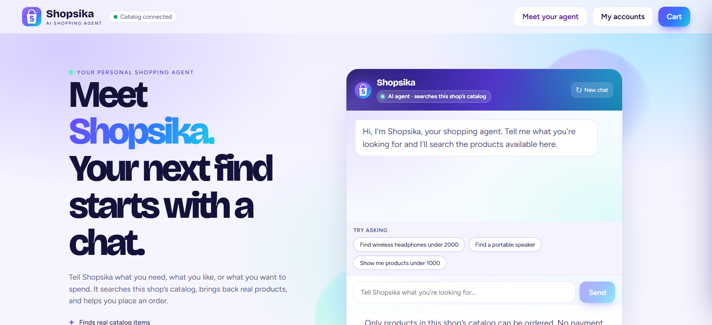

# 🛍️ Shopsika

<p align="center">
  
</p>

Shopsika is an **AI-Powered Shopping Agent**. The agent helps customers discover products in a live catalog, answer questions about specific items, and guide them through checkout using natural-language conversation. Groq powers the conversational responses, while the agent grounds product details in the catalog and the backend verifies stock, prices, and order confirmation.

> **Demo checkout:** No real payment is processed. Do not enter card numbers, CVVs, PINs, or banking credentials.

## 📸 Preview



## ✨ Features

- AI shopping agent that searches the live catalog and answers product questions
- Natural-language product discovery and guided checkout
- React storefront with catalog search, category filters, and product cards
- Product details and stock information from the backend
- Cart checkout and chat-guided checkout
- Server-side price and stock validation when creating an order
- SQLite persistence for products, sessions, and demo orders
- FastAPI interactive API documentation at `/docs`

## 🗂️ Project structure

```text
shopsika/
|-- backend/
|   |-- agent.py               # Agent conversation, product search, checkout flow
|   |-- database.py            # SQLite schema and catalog synchronization
|   |-- demo_products.json     # Catalog seed data
|   |-- main.py                # API routes and application startup
|   |-- schemas.py             # API request and response models
|   |-- test_chat_workflow.py  # Agent and checkout workflow tests
|   |-- requirements.txt       # Python dependencies
|   `-- README.md              # Backend setup and API details
`-- frontend/
    |-- src/                   # Agent interface, catalog UI and styles
    |-- public/                # Static assets and project screenshot
    |-- package.json           # Frontend dependencies and scripts
    |-- package-lock.json      # Locked frontend dependency versions
```

## 🚀 Requirements

- Python 3.10 or newer
- Node.js 18 or newer and npm
- Optional: A Groq API key for AI-assisted chat. Catalog search still works without it.

## 💻 Run locally

Start the backend first. In PowerShell:

```powershell
cd backend
py -m venv .venv
.venv\Scripts\Activate.ps1
python -m pip install -r requirements.txt
Copy-Item .env.example .env
```

Edit `backend/.env` and add your Groq API key if you want AI-assisted chat. Keep the key private and never put it in frontend configuration. Then start the API:

```powershell
python -m uvicorn main:app --reload
```

In a second terminal, start the frontend:

```powershell
cd frontend
npm ci
npm run dev
```

Open <http://127.0.0.1:5173>. Create an account in the app to access the storefront. The frontend uses `http://127.0.0.1:8000` as its default backend address.

## ⚙️ Configuration

### Backend

Copy `backend/.env.example` to `backend/.env` and set:

| Variable | Purpose |
| --- | --- |
| `GROQ_API_KEY` | Optional key for AI-assisted shopping chat. |
| `GROQ_MODEL` | Groq model used for chat; choose one available to your account. |
| `FRONTEND_ORIGINS` | Comma-separated browser origins allowed by CORS. |
| `DATABASE_PATH` | Optional SQLite file path. Defaults to `backend/shopsika.db`. |

### Frontend

Copy `frontend/.env.example` to `frontend/.env` only if you need to change the API address. Set `VITE_API_BASE_URL`, for example:

```env
VITE_API_BASE_URL=http://127.0.0.1:8000
```

Never put the Groq API key in a frontend variable.

## 🛒 Demo catalog

Edit `backend/demo_products.json` to change the sample catalog. The backend syncs this list into SQLite on startup. The database is created automatically when the backend first runs.

## 🔌 API routes

| Method | Route | Purpose |
| --- | --- | --- |
| `GET` | `/api/health` | Check that the API is available. |
| `GET` | `/api/products` | List and search catalog products. |
| `GET` | `/api/products/{product_id}` | Get one product. |
| `POST` | `/api/chat` | Send a message to the shopping assistant. |
| `POST` | `/api/orders` | Create a confirmed demo order. |
| `GET` | `/api/orders` | List orders for the current browser session. |
| `GET` | `/api/orders/{order_number}` | Retrieve an order confirmation. |

Interactive documentation is available at <http://127.0.0.1:8000/docs> while the backend is running.
